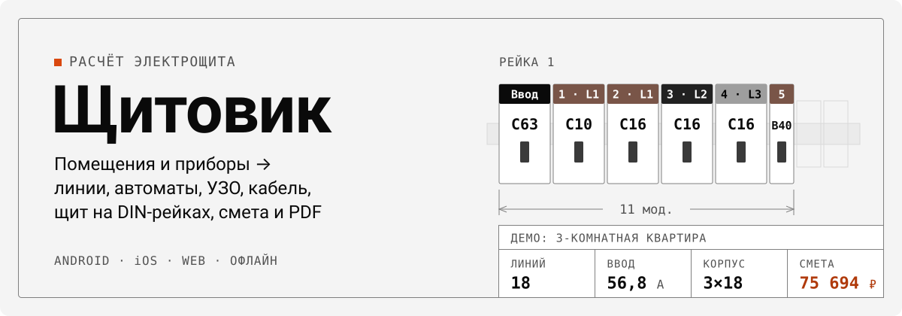
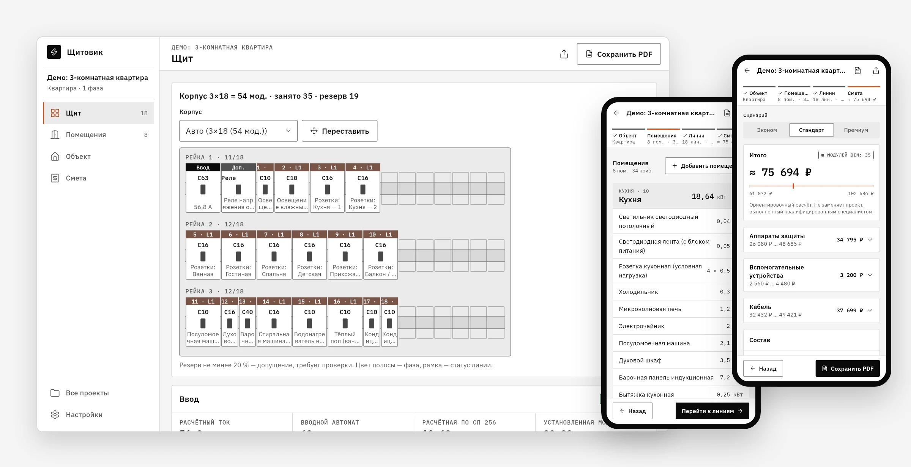
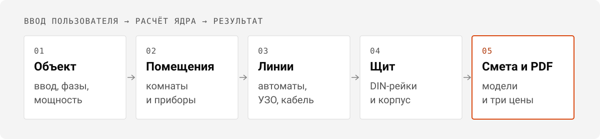

<p align="center">
  <picture>
    <source media="(prefers-color-scheme: dark)" srcset="./assets/readme/hero-dark.svg">
    
  </picture>
</p>

<p align="center">
  <a href="https://github.com/8thgencore/shchitovik/actions/workflows/ci.yml"></a>
  
  
  
</p>

<p align="center">
  <a href="#возможности">Возможности</a> ·
  <a href="#как-считает">Как считает</a> ·
  <a href="#быстрый-старт">Быстрый старт</a> ·
  <a href="#устройство-репозитория">Устройство</a> ·
  <a href="#документы">Документы</a>
</p>

<p align="center">
  <picture>
    <source media="(prefers-color-scheme: dark)" srcset="./assets/readme/showcase-dark.webp">
    
  </picture>
  <br>
  <sub>Демо-проект «3-комнатная квартира»: щит на DIN-рейках, помещения и смета.</sub>
</p>

**Щитовик** — калькулятор электрощита для квартиры, дома, гаража или небольшого коммерческого
помещения. Опишите ввод, помещения и приборы, и приложение разобьёт нагрузку на линии, подберёт
автоматы, УЗО и кабель, разложит аппараты по DIN-рейкам и соберёт смету. Работает офлайн и без
регистрации: проекты хранятся только на устройстве.

> [!WARNING]
> Расчёт ориентировочный и не заменяет проект, выполненный квалифицированным специалистом.
> Монтаж выполняет электрик с допуском.

## Возможности

- **Линии** — освещение, розетки и выделенные линии для мощных приборов; шаблоны помещений.
- **Защита** — автоматы B/C/D, УЗО и дифавтоматы, вводной автомат по расчётной нагрузке.
- **Кабель** — сечение и три проверки: допустимый ток, падение напряжения, отключение при КЗ.
- **Фазы** — распределение однофазных линий по L1–L3 и перекос.
- **Щит** — раскладка по DIN-рейкам, корпус с резервом, ручная перестановка модулей.
- **Смета** — ~2000 моделей 10 производителей, три сценария: эконом, стандарт, премиум.
- **PDF** — таблица линий, баланс фаз, спецификация, смета и все допущения расчёта.
- **Обмен** — файл `.shchitovik` открывается на любой платформе и в веб-версии.

Простой режим подставляет значения по умолчанию; экспертный открывает все параметры линии:
способ прокладки, длину, материал, ручные правки аппаратов и сечений.

## Как считает

<p align="center">
  <picture>
    <source media="(prefers-color-scheme: dark)" srcset="./assets/readme/workflow-dark.svg">
    
  </picture>
</p>

Расчёт делает ядро на чистом Dart в [`engine/`](engine). Каждое правило ссылается на пункт нормы:

| Норма | Что берём |
|---|---|
| ГОСТ Р 50571.5.52-2011 (МЭК 60364-5-52) | допустимые токи кабелей, поправочные коэффициенты |
| ПУЭ-7 | время отключения при КЗ (1.7.79), УЗО в жилых помещениях (гл. 7.1) |
| ГОСТ IEC 60898-1 | время-токовые характеристики B, C, D |
| СП 256.1325800.2016 | расчётные нагрузки жилых зданий |

Хранится только ввод, ручные правки и выбор моделей; результаты каждый раз пересчитываются. Каждая
проверка показывает статус и допущения, на которых она основана. Формулы сверяет независимый
оракул на Python ([`verification/`](verification/VERIFICATION.md)): 403 вектора, 0 расхождений,
его чувствительность проверена мутациями.

## Быстрый старт

```bash
dart pub global activate fvm && fvm install   # Flutter 3.47.8 из .fvmrc
make bootstrap                                # зависимости и кодогенерация
make analyze && make test
cd app && fvm flutter run --dart-define-from-file=env/.dev.env
```

Параметры сборки (`--dart-define`): `ENVIRONMENT`, `CATALOG_URL`, необязательный `SENTRY_DSN`.
Остальные цели — `make help`.

## Устройство репозитория

```text
app/      точка входа, фичи и DI
common/   общие пакеты: common_ui («Чертёж»), переводы, БД, логи
engine/   ядро на чистом Dart, вне pub workspace
  electrical_core   токи, линии, защита, фазы, кабель, петля КЗ, нагрузка
  estimate_core     подбор аппаратов, совместимость, раскладка щита, смета
  norms_data        нормативные таблицы и каталоги (JSON с источником у каждой таблицы)
  report_pdf        PDF-отчёт
tools/    извлечение норм, каталог цен, иконки
```

Структура следует [sizzle_starter](https://github.com/hawkkiller/sizzle_starter). Правила кода — в
[AGENTS.md](AGENTS.md).

## Документы

| Документ | О чём |
|---|---|
| [docs/PLAN.md](docs/PLAN.md) | решения, что сделано, что осталось |
| [AGENTS.md](AGENTS.md) | структура и правила кода |
| [verification/VERIFICATION.md](verification/VERIFICATION.md) | проверка формул и данных |
| [docs/RELEASE.md](docs/RELEASE.md) | выпуск в магазины |
| [deploy/README.md](deploy/README.md) | сервер, Web и каталог |

## Сторонние компоненты

Шрифты IBM Plex (SIL OFL 1.1), иконки Lucide (ISC), каркас из sizzle_starter (Apache 2.0) — подробно
в [NOTICE](NOTICE).
